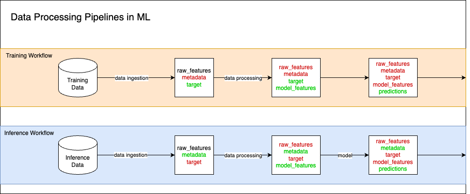

# Smart Pandas


`smart-pandas` provides a Pandas api extension for integrating machine learning data schemas via a config file and the open source Pandera package. The goal of the package is to simplify the data flow for end to end ML pipelines by having clear definitions for columns, and allowing easy accessability of column groups at all times.

Data validation is an important part of any data intensive application, and that includes machine learning projects. However most schema frameworks lack the flexibility and complexity to appropriately define schemas for ML datasets. As data flows through your ML pipeline, you code may add and/or remove columns at various stages, making a static schema difficult to maintain. Often you'll end up with various sets of column groupings with some semantic meaning, but no clear idea of what is available in the data at any given point in time. Smart Pandas solves this problem by allowing you to define a schema upfront which groups your columns into meaningful ML categories, and which can be dynamic based on the current stage of the ML process. Below are the key things that `smart-pandas` provides:

1. Semantic groupings of your data columns through `tags`, eg: `raw_features`, `model_features`, etc., and a convenient way to access those columns in your dataframe through the pandas api extension.
2. A tracked `state` of your dataframe based on the available columns, and the ability to dynamically build your Pandera schemas based on that state. For example, your schema may differ in your training and inference pipelines.
3. A `SmartDict` class for validating single-record dicts during inference, using a Pydantic schema derived from the same config.
4. PySpark schema export for logging to Delta Tables or creating Spark DataFrames.




The diagram above shows a simple example of the different semantic 'groups' of columns you may want moving through your ML data pipeline. Those groups can vary from stage to stage, and can even be different depending on which ML lifecycle stage you're at.


## Basic Usage

To use `smart-pandas`, all you need to do is swap your Pandas import to come from `smart-pandas`, which will give you access to the pandas api extension.

```python
from smart_pandas import pandas as pd
```
Next, you need to define your config as a `.yaml` file or a Python object. The config contains definitions for each column in your dataset. See the config documentation for more details on building your own config.

```yaml
{
  name: "life_expectancy_modelling_data",
  columns: [
    {
      name: "user_id",
      data_schema: {"dtype": "str"},
      tags: ["unique_identifier"],
      description: "Unique identifier for the person"
    },
    {
      name: "timestamp",
      data_schema: {"dtype": "datetime"},
      tags: ["row_timestamp"],
      description: "Timestamp of the data"
    },
    {
      name: "name",
      data_schema: {"dtype": "str"},
      tags: ["metadata"],
      description: "Name of the person"
    },
    {
      name: "weight",
      data_schema: {"dtype": "float"},
      tags: ["raw_feature"],
      description: "Weight of the person in kg"
    },
    {
      name: "height",
      data_schema: {"dtype": "float"},
      tags: ["raw_feature"],
      description: "Height of the person in cm"
    },
    {
      name: "age",
      data_schema: {"dtype": "int"},
      tags: ["raw_feature", "model_feature"],
      description: "Age of the person in years"
    },
    {
      name: "bmi",
      data_schema: {"dtype": "float"},
      tags: ["derived_feature", "model_feature"],
      description: "BMI of the person"
    },
    {
      name: "life_expectancy",
      data_schema: {"dtype": "int"},
      tags: ["target"],
      description: "Life expectancy of the person in years"
    },
  ]
}
```

Then you can initialise your `smart-pandas` config with your pandas dataframe, and begin accessing the `smart-pandas` attributes.

```python
data = pd.DataFrame(
    {
        "user_id": ["1", "2", "3"],
        "timestamp": [pd.Timestamp("2020-01-01"), pd.Timestamp("2020-01-02"), pd.Timestamp("2020-01-03")],
        "name": ["Emily", "Adam", "Charles"],
        "weight": [60, 74, 80],
        "height": [165, 182, 185],
        "age": [25, 30, 35],
        "life_expectancy": [90, 80, 80],
    }
)

data.smart_pandas.load_config(config_path="examples/example_config.yaml")

print(data.smart_pandas.raw_features)

#
#        weight  height  age
# 0      78     180   31
# 1      74     182   31
# 2      80     185   34
#
```

## Data Attributes
Data attributes are the semantic groupings of columns in your dataframe, and are defined by the `tags` in your config file. For more information on the available tags, see the [tags documentation](docs/tags.md). Currently available data attributes are:
- `raw_features`
- `derived_features`
- `model_features`
- `target`
- `unique_identifier`
- `row_timestamp`
- `metadata`
- `weight`

## State
`smart-pandas` tracks the synchronisation between the data columns and the configuration file through the `state` attribute. The `state` attribute represents a high level view of the data at certain phases in the ML data lifecycle. The state is built up of two attributes, the `StateName` and the `MLStage`. The `StateName` represents the current point in a specific data pipeline, whereas the `MLStage` identifies which data pipeline we are in. See the [state documentation](docs/state.md) for more details.

```python
data.smart_pandas.state

# StateName.RAW, MLStage.TRAINING
```

You can also pin the state manually, which is useful when columns are identical between states but types differ:

```python
data.smart_pandas.load_config(config_path="config.yaml", state="raw")

# Change state later
data.smart_pandas.set_state("processed")

# Clear the pin and re-enable automatic inference
data.smart_pandas.set_state(None)
```

## State-Dependent Types

Columns can have different data types depending on the state. For example, a column that is a string in RAW data but an integer after processing:

```yaml
name: age
data_schema:
  raw: {dtype: str}
  processed: {dtype: int}
tags:
  - raw_feature
  - model_feature
```

## Data Validation
`smart-pandas` uses Pandera for building data schemas to validate the data against. `smart-pandas` dynamically builds the schema based on the current state of the data, and the definitions in the config file.

```python
data.smart_pandas.validate(inplace=True)
```

## SmartDict

`SmartDict` provides the same config-driven validation for plain Python dicts, useful during real-time inference when data flows as single records. It subclasses `dict` so all standard dict operations work natively.

```python
from smart_pandas.smart_dict import SmartDict

record = SmartDict(
    {"user_id": "1", "name": "Ned", "age": 31, "bmi": 24.1, ...},
    config=config,
)

record.state           # State(name=PROCESSED, ml_stage=INFERENCE)
record.model_features  # {"age": 31, "bmi": 24.1}
record.validate()      # validates using Pydantic (no DataFrame conversion)
```

SmartDict uses a Pydantic schema (not Pandera) for validation, so there is no overhead from converting to a DataFrame. Schemas are cached per config+state for fast repeated validation.

## PySpark Schema Export

Both `SmartPandas` and `SmartDict` can export a PySpark `StructType` schema for the current state, useful for writing to Delta Tables or creating Spark DataFrames:

```python
spark_schema = data.smart_pandas.to_pyspark_schema()
# or
spark_schema = record.to_pyspark_schema()
```

Requires the optional pyspark dependency: `pip install smart-pandas[pyspark]`

## Python Config

Configs can be defined as Python objects instead of YAML files:

```python
from smart_pandas.config.data_config import DataConfig

config = DataConfig(
    name="my_dataset",
    columns=[
        {"name": "age", "data_schema": {"dtype": "int"}, "tags": ["raw_feature", "model_feature"]},
        {"name": "user_id", "data_schema": {"dtype": "str"}, "tags": ["unique_identifier"]},
        ...
    ],
)

data.smart_pandas.load_config(config=config)
```

See `examples/python_config_example.py` for a full example.

## Development
The package uses uv for it's package management, and pytest for it's unit test framework. To run unit-tests, use the following code:

```shell
uv run pytest tests/.
```
